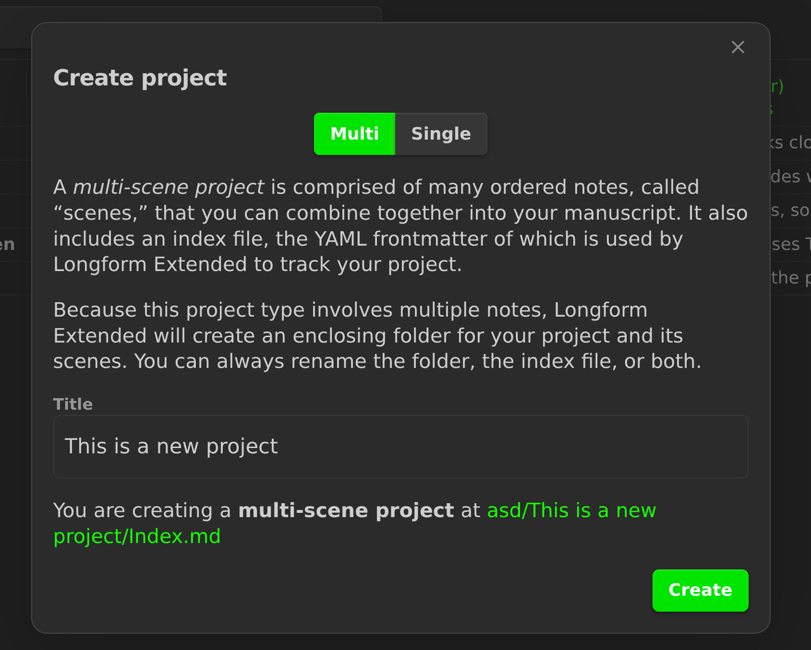
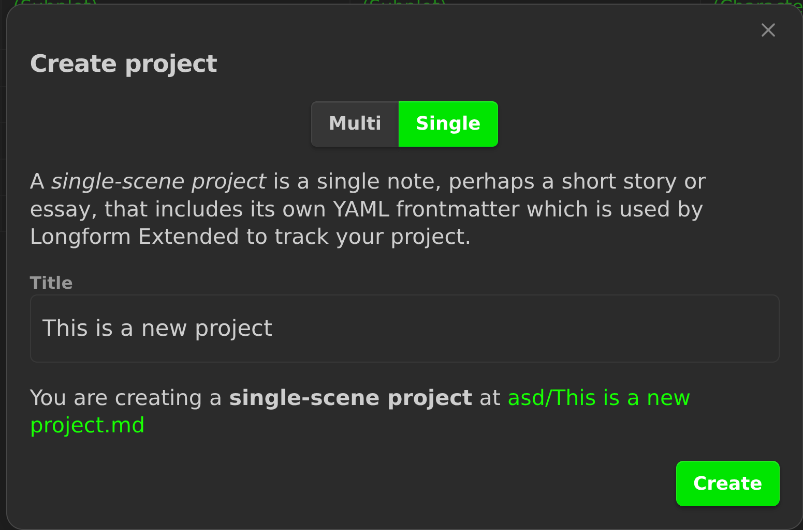

# Longform Extended

> [!NOTE]
> **This is a fork.** Longform Extended is [Longform](https://github.com/kevboh/longform) with configurable note groups and a small set of added views and writing stats, and nothing else. It is built to stay compatible with Longform's project data, so existing projects keep working. If you already use Longform, you should not need to change a thing.

## What This Is

Longform Extended is a plugin for [Obsidian](https://obsidian.md) that helps you write and edit novels, screenplays, and other long projects. It keeps everything Longform does — a series of notes, or _scenes_, organized into an ordered manuscript, single-note projects for shorter works, drafts, word counts, and compile workflows — exactly as they are, and adds **note groups** plus lightweight views and stats around the project.

Every multi-scene project has the built-in **Scenes**, **Subplots**, and **Characters** groups, and can add any number of custom groups, each with its own folder and **Notes** sub-tab. You can set display names for the built-in groups, and every group shares the same nested tree editing and create actions. The added views sit around the manuscript scenes and, where noted, the Subplot and Character Folders: a timeline, a kanban board, an editable subplot grid, and a status tab with a daily writing goal, alongside Longform's project, draft, and scene word counts.

Your core project data stays exactly as Longform expects it, so existing projects keep working without changes. The added views never edit note prose; their writes to your notes are the frontmatter they document: kanban status and helper properties, word counts, `plotgrid_*` keys, and the project note's note-group and display-name configuration and order overlays. They also write the generated timeline, kanban, and subplot grid files.

## What This Is Not

Longform Extended is not a full writing suite in the style of heavier plugins that bolt on elaborate metadata systems and story databases. There are no new required fields, no per-scene character or plot schema, and no overcomplicated configuration. A custom note group is just a name, a folder, an optional template, and an order overlay; folder membership decides which notes belong to it. It is just Longform, plus more note groups and a few views and stats around the project.

## Added Features

The additions are configurable note groups, plus views and stats around the project's scenes and built-in folders.

### Implemented

- **Timeline view** — see your scenes laid out along a timeline, driven by a
  per-scene `timeframe` value and a project-wide time format, with one
  transposed subplot table per populated hierarchy level when the subplot grid
  is enabled (see [Timeline](#timeline)).
- **Kanban board** — a status-driven board written to a configurable output
  path (see [Kanban](#kanban)).
- **Note groups** — built-in **Scenes**, **Subplots**, and **Characters**
  groups plus any number of custom groups, each with its own folder and
  **Notes** sub-tab. Built-in display names are configurable. All groups share
  nested tree editing and create actions (see [Extra note groups](#extra-note-groups)).
- **Subplot Grid** — an editable table of the subplots and characters in your
  Subplot and Character Folders across the levels of your scene hierarchy (see
  [Subplot Grid](#subplot-grid)).
- **Status tab** — a daily writing-goal bar plus actions to refresh all enabled
  generated files and open the timeline, kanban board, or subplot grid (see
  [Status tab](#status-tab)).


### Migrating

Existing Longform and Longform Extended projects need no migration for note
groups or these views: folder membership and the existing `longform`
frontmatter are enough. A project with no `noteGroups` entry simply has the
three built-in groups. Projects migrated from Longform 1.x get the added
features at their defaults; see
[Migrating from version 1 to 2](./docs/MIGRATING_FROM_VERSION_1_TO_2.md).

## Timeline

Longform Extended can generate a timeline for every project with scenes. The
note contains a Mermaid timeline diagram and a table, both ordered by a
per-scene timeframe value, so you can see the order of your story at a glance.
When the subplot grid is enabled, the scene table is replaced by one transposed
subplot table per populated hierarchy level. The timeline and the subplot grid
are both enabled by default. The timeline is driven by the manuscript scenes
and, for its subplot tables, the Subplot Folder; custom note groups do not add
rows. See [TIMELINE.md](./docs/TIMELINE.md) for the full documentation.

The Timeline section of the Project tab controls it:

- **Enable timeline** turns generation on or off. Turning it off stops future
  updates but leaves an existing timeline note in place.
- **Timeframe Tag Name** is the frontmatter property read from each scene.
- **Time Format** describes how timeframe values are written.
- **Timeline Output Path** is where the note is written.

### Timeframe Tag Name

The property that holds a scene's timeframe value. It defaults to `timeframe`,
so a scene might have:

```yaml
---
timeframe: "04/03/2026 09:30"
---
```

Rename it if `timeframe` clashes with something else in your vault, but use the
same property for every scene. Scenes with no timeframe value are quietly left
off the timeline; they are not reported as errors.

### Time Format

Choose the format whose biggest unit matches your story's span — smaller units
can be left off. The options are:

- **Epoch date time (num dd/mm/yyyy hh:mm:ss)** — an epoch number, then a
  day-first date, then a time, e.g. `2 04/03/2026 09:30:00`. The `num` is an
  epoch: a number for a span larger than a year, handy when a story crosses
  ages.
- **Epoch date time (num mm/dd/yyyy hh:mm:ss)** — the same, with a month-first
  date.
- **Date time (dd/mm/yyyy hh:mm:ss)** — a day-first date and a time, e.g.
  `04/03/2026 09:30:00`.
- **Time only (hh:mm:ss)** — just a time, for a story that stays within one
  day, e.g. `09:30:00`.
- **Chronological order (num)** — a single number that just orders scenes, like
  `1`, `2`, `3`.

You don't have to fill in every unit. You can drop units from right to left —
from the smallest up:

- `04/03/2026 09:30` — seconds omitted.
- `04/03/2026 09` — seconds and minutes omitted.
- `04/03/2026` — the whole time omitted.

You cannot drop units from left to right, so you can't drop the epoch or the
date and keep the time. Use the same number of units for every scene; mixed
values are reported as inconsistent. The exact minimum depends on the format
(see [Partial values](./docs/TIMELINE.md#partial-values)).

### Timeline Output Path

Where the timeline note is written. It defaults to `Build/$1_timeline.md`,
where `$1` is replaced with the project title. Relative paths are resolved
against the project folder; start with `/` to write from the vault root. The
`.md` extension is added if you leave it off, and any missing folders are
created. Changing the path writes a new note but does not move or delete the
old one. See [TIMELINE.md](./docs/TIMELINE.md#output) for details.

### Subplot Tables

When the subplot grid is enabled, the timeline note's scene table is replaced
by one transposed subplot table per populated hierarchy level. Each table's
first column is headed **Subplot**. Its rows are **Full Story**, then **Main**
if a note named `Main` exists (the main plot), then every other subplot note in
the **Subplot Folder**, alphabetically; those other subplot notes are the
subplots. Its columns are the timeline's time groups, each headed by the
primary value, the units between the primary and secondary unit, and the
cadence. At the deepest (scene) level, each cell lists links to the scenes for
that row at that time; shallower tables link ancestor nodes instead.

Tables are ordered deepest first and then the levels above them (for example
Level 2, then Level 1, then Level 0), under generic headings such as
`Level 2 — Scene 1, Scene 2, …`. The deepest table links scene notes; shallower
tables link each scene's ancestor node at that level. Ancestor links come from
the scene hierarchy, not from shallower-level subplot-grid cells. Level labels
are generic: act, chapter, and scene names are only sample node titles. A
single-level hierarchy gets one table with no level heading.

The main plot and each subplot mention a scene through a non-empty scene-level
subplot-grid cell, a wikilink, or the scene's exact title in that row's note.
The timeline uses the subplot grid's deepest (scene) level for these mentions;
it has no level setting of its own. Scenes that neither the main plot nor any
subplot mentions are listed after the tables under
**These scenes have not been mentioned in any subplot line**. Disable the
subplot grid to get the original scene table back. See
[TIMELINE.md](./docs/TIMELINE.md#the-subplot-tables) for details.

### When It Updates

The timeline refreshes automatically when the plugin loads and when files in
the project change. Run **Rebuild timeline** from the command palette to force
a rebuild; the command is available when a scenes project with the timeline
enabled is selected.

If any scene has an invalid or inconsistent timeframe, the note is replaced
with a **Problems** list and the diagram is omitted until you fix them. The
generated timeline is a build artifact: edits made inside it are overwritten on
the next rebuild.

## Kanban

A Kanban board is generated for each scenes project as a native Obsidian Bases
file (`.base`) with a Kanban view. It requires **Obsidian 1.14 or newer**; no
community kanban plugin is needed. Each card is a listed scene, or a note from
the Subplot Folder when **Include subplots** is enabled. The board shows the
configured columns plus the synthetic `Unassigned` and `Incorrectly Assigned`
columns when they contain cards. Dragging a card writes the column title back
into that note's `status` frontmatter. The board is enabled by default. See
[KANBAN.md](./docs/KANBAN.md) for the full documentation.

The Kanban section of the Project tab controls it:

- **Enable kanban** turns generation on or off. Turning it off stops future
  updates but leaves an existing board in place.
- **Kanban Columns** lists the columns, in board order.
- **Show notes with no status** includes unassigned notes in an `Unassigned`
  column (off by default).
- **Save word counts** writes each card scene's word count to its frontmatter.
- **Include subplots** adds notes from the Subplot Folder to the board alongside
  project scenes (on by default). Notes in the Character Folder or in custom
  note groups are never included.
- **Kanban Output Path** is where the board is written.

### Kanban Columns

Titles are separated by spaces. Quote any title that contains spaces, using
single or double quotes:

```
Planned Draft Reviewed
"To do" Draft "In progress" Done
```

The order you write them in is the order of the columns. The default is
`Planned Draft Reviewed`, and clearing the field falls back to it. Matching is
case-sensitive: `draft` does not match `Draft`.

### Status

A card note's column comes from its `status` frontmatter:

```yaml
---
status: Draft
---
```

Dragging a card to another column writes that column title into `status`, so
the board and the notes stay in sync. Notes with a missing or empty status are
hidden unless **Show notes with no status** is enabled. Statuses that don't
match a configured column all share a single `Incorrectly Assigned` column
instead of becoming columns of their own; add the column or fix the status,
then rebuild. Notes from the Subplot Folder follow the same status, drag,
unknown-status, and unassigned rules as scenes.

The board includes scenes that are listed in the project and are not
structural containers. Unlisted notes in the scene folder are excluded even if
they have a status. With **Include subplots** on, it also includes the notes in
the Subplot Folder; notes in the Character Folder or in custom note groups are
never included.

A board is only generated when at least one scene, or (with **Include subplots**)
at least one note in the Subplot Folder, has a non-empty status, even if **Show
notes with no status** is enabled.

The board groups by the writable, plugin-managed `longformKanbanStatus`
frontmatter property rather than by `status` directly: Bases only writes a
dropped card's group back for an editable note property, and grouping by a
formula would make cards undraggable. The plugin mirrors the helper to `status`
and refreshes the helper when statuses change. See
[KANBAN.md](./docs/KANBAN.md#the-status-property) for details.

### Word Counts

With **Save word counts** enabled (the default), listed scenes with a
recognized status have their word count written to their frontmatter as
`wordCount`, and the board shows it as a card property. Scenes that are
containers, have no status, have an unrecognized status, or have no place in the
project's scene list do not get a word count written. Turning the setting off
stops the writes but leaves any existing `wordCount` values in place.

Notes in the Subplot Folder never get a word count generated or written. With
**Include subplots** off, the board shows `note.wordCount` for scenes as before.
With it on, the **Word Count** card property is computed by a display formula:
scenes keep their count and subplot cards are blank. With **Save word counts**
off, no word-count card property appears at all.

### Kanban Output Path

Where the kanban Base is written. It defaults to `Build/$1_kanban.base`, where
`$1` is replaced with the project title. Relative paths are resolved against
the project folder; start with `/` to write from the vault root. The `.base`
extension is added if you leave it off, and any missing folders are created.
Changing the path writes a new board but does not move or delete the old one.
See [KANBAN.md](./docs/KANBAN.md#output) for details.

### When It Updates

The board refreshes automatically when the plugin loads and when files in the
project change, and word counts are updated when Longform's scene counts change.
Toggling **Include subplots** regenerates the board; when it is on, changes to notes
in the Subplot Folder also refresh it. Run **Rebuild kanban** from the command
palette to force a rebuild; the command is available when a scenes project with
the kanban enabled is selected. The generated board is a build artifact: edits
made inside it are overwritten on the next rebuild.

The [Status tab](#status-tab)'s **Open kanban** action opens the configured
board and is disabled when the kanban is off.

## Subplot Grid

A subplot grid tracks your subplots and characters across the structure of your story.
It is generated for each project with scenes as a native Obsidian Bases file
(`.base`) with a transposed, editable view: notes from your Subplot and
Character Folders appear as columns, and the level you choose in the view
appears as rows. Cells write back to the notes' frontmatter, so the grid is a view of your
data rather than a separate database. It requires
**Obsidian 1.14 or newer**, and it is enabled by default. See
[PLOT_GRID.md](./docs/PLOT_GRID.md) for the full documentation.

The Subplot Grid section of the Project tab controls it:

- **Enable subplot grid** turns generation on or off. Turning it off stops future
  updates but leaves an existing Base and its `plotgrid_*` keys in place.
- **Subplot Grid Output Path** is where the Base is written. It defaults to
  `Build/$1_plotgrid.base`, where `$1` is replaced with the project title.

The **Level** selector lives in the generated Subplot Grid view, above the table.

The **Scene Folder**, **Subplot Folder**, and **Character Folder** settings live
in the **Project Metadata** section of the Project tab; custom group folders
live in the **Extra note groups** section. They share the same folder autocomplete,
which suggests folders relative to the project folder. All note-group folders
are project-folder-relative; a leading `/` does not mean the vault root. (That
rule applies only to output file paths.) New projects default the Scene Folder
to `Scenes`, the Subplot Folder to `Subplots`, and the Character Folder to
`Characters`, and each custom group's folder defaults to its name with spaces replaced by underscores. Existing
projects may keep custom folder names. For example, `Subplots/Main.md` is the
main plot. Migrated legacy projects may still have a project-root scene folder
(`/`); choose a distinct, non-nested scene folder before the subplot grid can
generate. The output path resolves against the project folder; start it with
`/` to write from the vault root. A `.base` extension is added if omitted.

Every note-group folder must be pairwise distinct and non-nested: no two may be
the same folder, and none may be a subfolder of another. The Project tab rejects
a folder change that would violate the rule and shows an error. For the Scene,
Subplot, and Character Folders, an invalid existing configuration also blocks
generation, and a manual rebuild reports a Notice until the paths are fixed.
Folder membership is the only thing that makes a note a subplot, a character,
or a member of a custom group; there is no `type` frontmatter flag to add.

### Levels

The **Subplot Grid** view has a **Level** dropdown above the table. It is not a
project setting and is not stored in the project frontmatter; an old
`plotGridLevel` value is removed when the project is saved.

A level is the zero-based rank of the distinct indentation values in the
project's scene list, not a raw indentation number:

```
Act 1                    level 0
  Chapter 1              level 1
    Scene 1              level 2
    Scene 2
  Chapter 2
    Scene 3
Act 2                    level 0
  Chapter 3              level 1
    Scene 4              level 2
```

For that hierarchy:

- Level 0 makes the `Act 1` and `Act 2` rows.
- Level 1 makes the `Chapter 1`, `Chapter 2`, and `Chapter 3` rows.
- Level 2 makes the scene rows.

The dropdown lists **All** plus each populated level, with labels built from the
hierarchy, such as `0 - (Act 1 - The Beginning, Act 2 - The Choice)`,
`1 - (Chapter 1 - Arrival, …)`, and `2 - (Scene 1 - The Train, …)`. The default
is level 0 when it exists, otherwise the first populated level, otherwise
**All**.

Selecting a level filters the rows to that level; **All** shows every level.
Rows follow the **Scenes** tab/tree document order. For **All**, levels are
grouped top-down (level 0, level 1, and so on) in tree order. Selecting a level
does not regenerate the Base.

The Base generates and preserves every level's `plotgrid_*` keys, but the
custom view shows only the selected level's rows. The native fallback table
shows all levels' columns.

Structural nodes need their own notes in the scene folder, as scenes do
elsewhere in Longform; otherwise Longform drops them and the levels shift.

### The Grid

The generated Base contains a custom **Subplot Grid** view with a **Level**
dropdown above the table, subplot and character notes as clickable column headers,
and the selected level's nodes as rows, plus a native **Subplot Grid (Table)**
view as a fallback. The main plot comes first: a note named `Main` is the main
plot, then the other subplots alphabetically, then the characters
alphabetically. The native fallback uses the same order. Because the Subplot and
Character Folders are distinct, headers show `(subplot)` or `(character)` on a
separate line above the name. Each cell shows only the value stored for that
row's hierarchy node; a higher level does not mirror values from deeper levels.

Click a cell to edit it. Text, number, and checkbox values get a matching
editor; Enter or clicking away commits, and Escape cancels. Only scalar
`plotgrid_*` values are editable. Lists and objects are read-only, and edits go
to that column's subplot or character note, not to the `.base` file. The Base is a
build artifact: manual edits to its YAML or views are overwritten when it is
regenerated.

### When It Updates

The grid refreshes automatically when the plugin loads and when project
settings, the scene hierarchy, or files in the project, scene, or Subplot and
Character Folders change. Run **Rebuild subplot grid** from the command palette
to force a rebuild; the command is available when a scenes project with the
subplot grid enabled is selected.

In the [Status tab](#status-tab), **Refresh** regenerates every enabled generated
file — the timeline, kanban board, and subplot grid — and **Open subplot grid**
opens the configured Base. The open action is disabled when the subplot grid is
off. If the file has not been generated yet, a notice asks you to use
**Refresh**.

## Status tab

Multi-scene projects have a **Status** tab with a daily writing-goal bar and
four actions:

- **Refresh** regenerates every enabled generated file for the selected
  project: the timeline, the kanban board, and the subplot grid. It is disabled
  while it runs, and when no generated file is enabled.
- **Open timeline**, **Open kanban**, and **Open subplot grid** open their
  configured output. Each action is disabled when its feature is off. If the
  output has not been generated yet, a notice asks you to use **Refresh**.

The goal bar uses the latest writing session and the **Goal applies to**
setting; see [Word counts and sessions](./docs/WORD_COUNTS.md#the-daily-goal-bar).
Single-note projects have no **Status** tab; **Status** redirects to
**Project**.

## Extra note groups

Multi-scene projects get a **Notes** tab with one sub-tab per note group. The
built-in groups are **Scenes**, **Subplots**, and **Characters**, and a project
can add any number of custom groups; the pane opens on **Notes → Scenes** by
default. Single-note projects have only the **Project** and **Compile** tabs;
**Notes** and **Status** redirect to **Project**.

The **Scenes** sub-tab is Longform's manuscript tree. Every other sub-tab lists
the Markdown notes in its configured folder and lets you create, rename,
reorder, and nest those notes from the pane. There is no `type` flag: folder
membership decides whether a note belongs to a subplot, a character, or a
custom group. The Subplot and Character groups feed the subplot grid, and the
Subplot Folder also feeds the timeline subplot tables and the kanban board's
**Include subplots** option. Custom groups are browsing and editing trees only;
they do not add rows, columns, generated files, or per-group word-count stats to
those views.

A custom group's name is also its display name. Display names for the built-in
**Scenes**, **Subplots**, and **Characters** groups are set under **Project
Metadata** in the Project tab. Display names change labels throughout the
extension, including the Notes sub-tabs and generated subplot-grid labels;
folders, note paths, and frontmatter do not change. Leaving a built-in display
name blank restores the default. See
[PLOTS_AND_CHARACTERS.md](./docs/PLOTS_AND_CHARACTERS.md) for the built-in
Subplots and Characters details.

Custom groups are configured in the **Extra note groups** section of the Project tab.
List their names in order, separated by spaces, and quote a name that contains
spaces. Each group's folder defaults to its name with spaces replaced by
underscores and is relative to the project folder. Each group also has an
optional Template setting. Every note-group folder must be pairwise distinct
and non-nested.
Removing a group from the list removes only its configuration, tab, and order
overlay: its folder and notes are never deleted from the vault.

The sub-tabs are organizational. The subplot grid and timeline read the folders
directly, so sub-tab order and indentation do not change the grid or the
timeline subplot tables.

### Creating Notes

Each non-scenes sub-tab has a **New Subplot**, **New Character**, or
**New <Group>** field at the bottom that creates a note in the configured
folder. Press Enter to create and open it, or Shift+Enter to create it without
opening. Duplicate names, and names with invalid filename characters, are
rejected with an inline error.

New notes in the **Subplots** and **Characters** sub-tabs use the project's
**Subplot Template** or **Character Template** from **Project Metadata**, next
to **Scene Template**. If a project template is not set, the global **New
subplot template** or **New character template** in plugin settings applies.
All of these template settings default to none. Templates are processed like
scene templates: Templater if enabled, otherwise the core Templates plugin.
Custom groups use the Template setting shown under their folder in the
**Extra note groups** section; an empty value creates plain notes. See
[Templates](./docs/PLOTS_AND_CHARACTERS.md#templates).

### Organizing Notes

Drag a note to reorder it, or drag horizontally to indent it; the global
**Indent scene** and **Unindent scene** commands also work on the active note in
any non-scenes group. Notes with children can be collapsed. Click a note to open
it.

The right-click menu (desktop) provides inline rename, delete, open in new pane,
and add-new above or below. Inline rename commits with Enter and cancels with
Escape or a click away; it writes the renamed note to the root of its configured
folder. Deleted notes are moved to the trash.

Each group's folder owns membership. The project note stores only an
order/indent overlay: notes missing from it are appended alphabetically at the
top level, deleted entries are pruned, and reordering or indenting changes the
overlay rather than the notes. The overlay is keyed by basename, so duplicate
basenames in nested subfolders collapse to the first path. Custom groups
reconcile the same way. See
[Membership and order](./docs/PLOTS_AND_CHARACTERS.md#membership-and-order-overlay).

## Examples

The repository includes four source-only sample projects in
[`examples/`](./examples/README.md): a short story, a long story, an essay,
and a screenplay. Each is ready to copy into a vault. The essay uses
Arguments and References in place of plots and characters.

## Installing Longform Extended

Once Longform Extended is listed in the Community plugins directory, install it from **Settings → Community plugins** in Obsidian.

To install manually, copy `main.js`, `manifest.json`, and `styles.css` into `.obsidian/plugins/longform-extended/` in your vault, then enable the plugin from **Settings → Community plugins**. `longform-extended` is this fork's plugin folder name; it is not upstream Longform's `longform/` folder.

## Removed: user-script compile steps

Longform Extended 1.0.0 removed user-script compile steps. The feature executed arbitrary user-provided `.js` files from the vault and was removed for security and linter compliance. The same `window.eval` loader shipped in Longform 2.1.0 (2025-03-19). ESLint's `no-eval` rule has existed since ESLint v0.0.2; what changed is Obsidian's review enforcement. Obsidian's automated community review went live in May 2026, allowing existing releases a temporary exception but new releases/plugins now need to comply.

## Longform

Longform is a plugin for [Obsidian](https://obsidian.md) that helps you write and edit novels, screenplays, and other long projects. It lets you organize a series of notes, or _scenes_, into an ordered manuscript. It also supports single-note projects for shorter works.

Major features include:

- A dedicated sidebar that collects your projects from across your vault;
- A [reorderable, nestable list](./docs/MULTIPLE_SCENE_PROJECTS.md) of scenes;
- Scene/draft/project [word counts](./docs/WORD_COUNTS.md#word-counts-for-projects-drafts-and-scenes);
- Daily [writing session goals](./docs/WORD_COUNTS.md#writing-sessions-and-word-count-goals) with lots of options to help fit your writing style;
- A [workflow-based compilation tool](./docs/COMPILE.md) that can create manuscripts from your projects;
- Support for [single-scene projects](/docs/SINGLE_SCENE_PROJECTS.md) so that your shorter works can use the same workflows and tooling as your longer ones;
- Plus lots of commands, modals, and menu items to help you manage your work.

A Getting Started guide follows; there is also reasonably-complete [documentation](./docs/).

## Installing

Longform is in the Community Plugins section of Obsidian’s settings. You may also install it manually by copying the `main.js`, `manifest.json`, and `styles.css` files from a release into a `longform/` folder in the `.obsidian/plugins` folder of your vault. The Community Plugins interface is preferred.

## Getting Started

Longform works by searching your vault for any note that contains a frontmatter entry named `longform` (don’t worry if you don’t know what that means; Longform includes tools to help you generate these files). You can think of these notes as the “spines” or tables of contents of your projects. Let‘s walk through creating two different Longform projects: a novel and a short story.

### Creating a Novel

1. To begin, find or create a folder somewhere in your vault in which you’d like to create your novel. Right-click it and select `Create Longform Project`.


2. A `Create Project` modal will appear. This modal lets us choose between Multi- and Single-scene project types. We’re creating a novel, so we’ll stick with Multi. The text under the project type switch explains a little about how each type of project works.

3. In the `Title` field, enter your novel’s title. For this example we’ll use `My Great Novel`. The modal tells us the type of project we’re creating and the location of the _Index File_ it will create in our vault. We’ll get into what Index Files are in a moment.



> **Note**
>
> You don’t have to use this menu item and modal to create Longform projects. As you will see shortly, Longform projects are one or more notes organized around some YAML frontmatter. You can always create a note yourself somewhere in your vault and use the `Insert Multi-Scene Frontmatter` and `Insert Single-Scene Frontmatter` commands to populate the note—Longform will recognize it automatically. Although not recommended, you can also author the YAML frontmatter manually, too.

4. Click `Create`. Longform has created the promised file. If we switch to the [Longform pane](./docs/THE_LONGFORM_PANE.md) in the sidebar the project is already selected. You should see three tabs: Scenes, Project, and Compile, and Scenes should be selected.


5. That _New Scene_ placeholder is a text field—click it and enter something that sounds like the first scene of a novel, maybe “The Sun Rises on Dublin,” and press enter. You should now be editing a so-named note, and your scene should appear in the Scenes tab:


6. Your editor also now has the scene open and ready to write. If you click the small `My Great Novel/Index.md` link under your project name, you’ll be taken back to the index file where you’ll see your new scene listed under the `scenes` frontmatter entry:

```yaml
scenes:
  - The Sun Rises on Dublin
```

This is how Longform tracks your work.

> **Warning**
>
> You should probably avoid editing the `longform` frontmatter in your index file directly unless you really know what you’re doing. Longform supports direct editing of it and will do its best to sync, but it’s easy to accidentally mess things up. You can always revert your changes, though: Longform will never delete files based on changes in the index file.

7. You’re now ready to write your novel. Keep adding scenes as needed. If you’d like to add structure to your novel you can drag scenes left or right (or use the indent/Unindent commands) to create folders of scenes with parent scenes. [The full documentation for multiple-scene projects](./docs/MULTIPLE_SCENE_PROJECTS.md) might be useful.

8. When you’re ready to generate a single manuscript for your readers, use the [Compile](./docs/COMPILE.md) feature. Congratulations! You’ve written a novel.

### Creating a Short Story

Longform also supports [single-scene projects](./docs/SINGLE_SCENE_PROJECTS.md) that live as a single note in your vault. Let’s create one.

1. Right-click the enclosing folder as before and select the `Create Longform Project` menu item.

2. In the Create Project modal, choose `Single`. Let’s write something noirish and call it `On the Rooftops`.



3. Click Create. Because this is a single-scene project, there is only one note associated with it and Longform will open it automatically. The frontmatter at the top tells Longform how to track your project; we’ll write the story in the note itself.

4. Write your story! When you’re ready, you can use the Compile tab to generate a manuscript. Single-scene projects can use scene and manuscript steps in any order.

## Drafts & Projects

Longform supports the creation of multiple _drafts_ for a given project. Under the hood, drafts are just different Longform projects with the same title—they are then grouped together by Longform and presented as different versions of the same project.

To create a new draft of a project use the new draft (+) button in the Project tab, or create an entirely new project somewhere and set the title in the Project tab to be the same as your existing project.

You can rename drafts by right-clicking them in the Project tab and selecting Rename, or by setting the `draftTitle` attribute in their `longform` frontmatter.

## Compiling

The Compile tab allows you to create custom workflows that turn your project into a manuscript. See [COMPILE.md](https://github.com/kevboh/longform/blob/main/docs/COMPILE.md) for more.

> [!TIP]
> You can find more compile steps for various use cases in the [community collection of compile steps](https://github.com/obsidian-community/longform-compile-steps).

## Scene-only Styling

Longform will automatically attach a `.longform-leaf` class to the container panes of any notes that are part of a Longform project. This means you can add custom CSS snippets to Obsidian that style your writing environment and _only_ your writing environment. For example, I prefer a dark theme for Obsidian but a light theme for writing, so my writing snippet looks something like this:

```css
/* Set some variables for the entire leaf. */
.longform-leaf {
  --background-primary: white;
  --background-primary-alt: white;
  --background-secondary: white;
  --background-secondary-alt: white;
}

/* Style the editor. */
.longform-leaf .markdown-source-view {
  --background-primary: white;
  --background-primary-alt: white;
  --background-secondary: white;
  --background-secondary-alt: white;
  --text-selection: #aaa;
  --text-normal: black;
  color: black;
  background-color: white;
}

/* Style text selection. */
.longform-leaf .suggestion-item.is-selected {
  background-color: var(--text-accent);
}

/* Style the header of the leaf. */
.longform-leaf .view-header {
  background-color: white;
}

/* Style the text content of the leaf header. */
.longform-leaf .view-header-title {
  --text-normal: black;
}
```

Longform’s own UI will always use existing Obsidian CSS theme variables when possible, so it should always look at home in your theme.

## Troubleshooting

First, the most important bit: **Longform is built specifically to never alter the contents on your notes.** The only note it rewrites is a project’s index file. As such, Longform can’t delete or lose your notes.

Longform does a lot of complex tracking to bridge a project’s metadata with the state of files on disk. Although it tries to cover lots of edge cases, it is possible to cause desync between what Longform thinks is happening with projects and what’s actually going on. Most often this occurs when a project’s frontmatter is malformed or invalid in some way. Because projects are inferred from frontmatter, if your frontmatter is correct you can always restart Obsidian (or choose the "reload without saving" command) to force Longform to recalculate projects.

## Sponsorship

Any [sponsorship](https://github.com/sponsors/wandrade) is deeply appreciated, although by no means necessary.

## License

This fork is dual-licensed.

- The original [Longform](https://github.com/kevboh/longform) code remains under its original license, the Fuck Around and Find Out License. See [LICENSE.md](./LICENSE.md). You can view that license’s history [here](https://git.sr.ht/~boringcactus/fafol/tree/master/LICENSE.md).
- All additions and changes made in this fork are under a separate license that allows private use and modification but requires consent for redistribution. See [LICENSE-ADDITIONS.md](./LICENSE-ADDITIONS.md).
