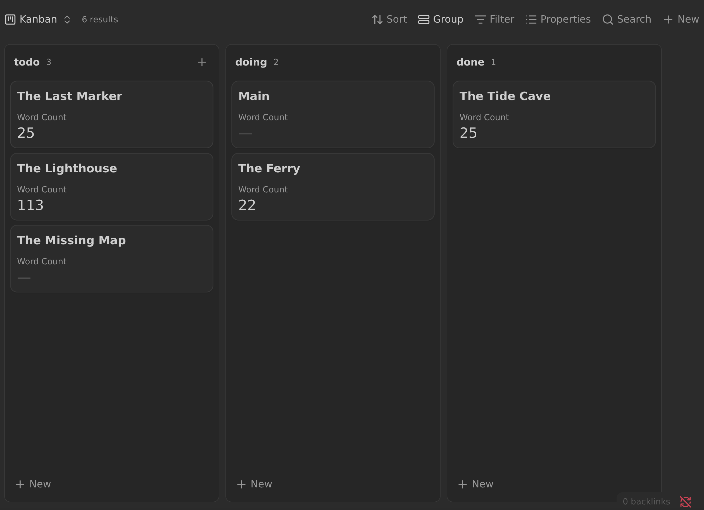

# Kanban

A project with scenes can generate a kanban board at a configured output path.
The board is a native Obsidian Bases file (`.base`), opened in the built-in
Kanban view. It requires **Obsidian 1.14 or newer**; enable Obsidian's **Bases**
core plugin. No community kanban plugin is needed. Only multi-scene projects get
a board; single-scene projects do not.

The board shows the notes in the project's **Scene Folder** that carry a
`status`. With **Include subplots** enabled (the default), it also shows notes
in the configured **Subplot Folder** on the same terms. Notes in the **Character Folder** are never included. Dragging a card to
another column writes that column's title into the note's `status` frontmatter
directly, so the board and the notes stay in sync.



## Configuration

The Kanban section of the Project tab controls the feature:

| Setting | Default | What it does |
| --- | --- | --- |
| **Enable kanban** | On | Turns generation on or off. |
| **Kanban Columns** | `Planned Draft Reviewed` | The columns, in order. |
| **Kanban Output Path** | `Build/$1_kanban.base` | Where the board is written. |
| **Show notes with no status** | Off | Shows notes with an empty `status` in Bases' own `None` group. Off filters them out of the board. |
| **Save word counts** | On | Writes each card scene's word count to its frontmatter. |
| **Include subplots** | On | Includes notes from the Subplot Folder on the board. The visible label follows the project's Subplots Display Name. |

Turning **Enable kanban** off stops future rebuilds and removes the **Rebuild
kanban** command for that project, but it does not delete an existing board.

**Include subplots** adds the notes in the configured **Subplot Folder** as
candidate cards, whether or not they are listed in the project's scenes. The
Subplot Folder defaults to `Subplots`; existing projects may keep a custom
folder. There is no `type` flag: membership in the Subplot Folder is the only
requirement.

The checkbox's visible label follows the project's **Subplots Display Name**, so
a display name of `Threads` makes it read **Include threads**. This is a label
change only: the setting, the stored `kanbanIncludePlots` key, and the Subplot
Folder are unchanged. See
[PLOTS_AND_CHARACTERS.md](./PLOTS_AND_CHARACTERS.md#display-names).

## Kanban Columns

Set the columns in the Project tab under **Kanban Columns**. Titles are
separated by spaces. Quote any title that contains spaces, using single or
double quotes:

```
Planned Draft Reviewed
"To do" Draft "In progress" Done
```

The order you write them in is the order of the columns on the board. The
default is `Planned Draft Reviewed`. Clearing the field falls back to that
default.

Column titles are also the values written to `status` when cards are dragged.

`Incorrectly Assigned` is a reserved title used by the holding column described
below. Do not add it to **Kanban Columns**. If you do, the holding column merges
with the configured one.

## The Status Property

A card note's column comes from its `status` frontmatter property:

```yaml
---
status: Draft
---
```

The value must match a configured column exactly. Leading and trailing
whitespace is ignored, but case is not. Notes from the Subplot Folder use the
same property and the same rules as scenes.

The generated board groups by `note.status` itself. Because `status` is a
writable note property, Bases writes a dropped card's new column straight into
the note, with no intermediate property.

A non-empty status that matches no configured column is rewritten in the note
to the reserved value `Incorrectly Assigned`. The original value is not stored
anywhere, so a typo is gone once the rewrite happens. See
[Statuses That Are Not Columns](#statuses-that-are-not-columns).

Notes with a missing or empty status are handled by **Show notes with no
status**. See [Notes Without a Status](#notes-without-a-status).

### New Notes

When the kanban is enabled, creating a new scene or subplot note sets `status`
to the first configured column. When **Kanban Columns** is empty, it uses the
first column of the default list. This runs after any template is applied and
never overwrites a non-empty status the template already set. Character notes
and notes in custom groups never get a status.

## What Appears on the Board

The board is a folder query, not a scene-list query. It shows:

- Notes in the Scene Folder that carry a `status`. This includes notes that are
  not listed in the project's scenes. A structural container (a scene followed
  by a more-indented scene) appears only if it has a status.
- When **Include subplots** is on, notes in the configured Subplot Folder that
  carry a `status`. They do not need to be listed in the project's scenes.

Notes in the Character Folder and notes in extra note groups are never shown.
A note with no status appears only when **Show notes with no status** is
enabled.

The generated Base filters to the scene folder and, when **Include subplots**
is on, the Subplot Folder as an OR choice. When **Show notes with no status** is
off, it also requires a non-empty `status`.

## Notes Without a Status

By default, notes with a missing or empty `status` are excluded from the board.
The generated Base requires a non-empty `status` in that case. Enable **Show
notes with no status** in the Project tab to include them. They then appear in
Bases' own `None` group. There is no synthetic unassigned column.

A board is only written when at least one listed non-container scene, or (with
**Include subplots**) at least one note from the Subplot Folder, has a non-empty
status. So enabling **Show notes with no status** on a project where every such
note is unassigned does not create a board.

## Statuses That Are Not Columns

If a listed scene's status, or (with **Include subplots**) a Subplot Folder
note's status, does not match any configured column, the plugin rewrites the
note's `status` to `Incorrectly Assigned`. The original value is not stored
anywhere. That column is placed after the configured columns and appears
only when at least one note was rewritten. Unrecognized status values never
become their own columns.

A value is unrecognized when it differs at all, including by case: `draft` does
not match `Draft`. Fix the note's `status` or drag the card into a configured
column. Adding the original value to **Kanban Columns** later does not bring a
rewritten note back, because the note now says `Incorrectly Assigned`. Set its
status again.

`Incorrectly Assigned` is a holding area, not an assignable status. Dragging a
card into that column writes the reserved value to the note, and the card stays
there until you move it to a configured column or correct its status.

## Word Counts

With **Save word counts** enabled (the default), each listed scene that appears
as a card in a configured column has its word count written into its frontmatter
as `wordCount`:

```yaml
---
status: Draft
wordCount: 1234
---
```

The value comes from Longform Extended's scene word counts, and it is updated when those
counts change. Scenes with no status, an unrecognized status, no entry in the
project's scene list, or a container role do not have `wordCount` written.
Turning **Save word counts** off stops the writes and removes the card property,
but does not remove `wordCount` values that were already written.

No word count is generated or written to notes in the Subplot Folder. The
board's **Word Count** card property depends on the two settings:

- **Include subplots off:** scenes show `note.wordCount` as before.
- **Include subplots on:** the board uses a display formula for the card property.
  It shows a scene's `wordCount` and is empty for cards from the Subplot Folder.
- **Save word counts off:** no word-count card property appears, regardless of
  **Include subplots**.

`wordCount` is a normal frontmatter property, so it also appears in Obsidian's
Properties panel for the scene.

## Output

The board is written to the path set in the Kanban section of the Project tab
(**Kanban Output Path**). The default is `Build/$1_kanban.base`, where `$1` is
replaced with the project title, so a project named *My Book* produces
`Build/My Book_kanban.base`.

See [Generated files](./GENERATED_FILES.md) for how output paths, extensions,
and build artifacts work.

No board is written when no listed non-container scene has a status. With
**Include subplots** on, a note from the Subplot Folder with a status is enough.
In that case an existing board at the configured path is left untouched.

## Updating and Rebuilding

The board refreshes automatically when the plugin loads and when files in the
project change, including notes in the scene folder that are not listed as
project scenes. When **Include subplots** is on, changes to notes in the Subplot
Folder also refresh the board. A card drop writes `status` directly to the
note through Bases, which triggers a rebuild. The rebuild regenerates the
board. These writes are idempotent.

It also rebuilds when project settings that affect it change, such as the
columns, the show-notes-with-no-status setting, save word counts, include
subplots, or the output path. Word counts are also written when Longform
Extended's recorded scene word counts change.

The plugin ignores its own generated files when watching for changes, including
boards written to a custom output path, so writing the board does not trigger
another rebuild.

To force a rebuild, select the project and run **Rebuild kanban** from the
command palette. The command is only available for a multi-scene project with
the kanban enabled. It reports `Kanban rebuilt.` even when there was nothing to
write.

The Overview block's **Open kanban** action opens the configured board and is
disabled when the kanban is off. The refresh action regenerates every enabled
generated file, including the board. If the board has not been generated, a
notice asks you to use the refresh action. See [Overview](./OVERVIEW.md).

## Troubleshooting

- **No board was created.** Check that the kanban is enabled, that the project
  is a scenes project, and that at least one card note has a non-empty
  `status`. A project whose card notes are all unassigned produces no board.
- **A note is missing from the board.** Check whether its `status` is empty, its
  note file is missing, it sits outside the Scene and Subplot Folders, or it is
  in the Character Folder or an extra note group. A note in the Subplot Folder
  is included only when **Include subplots** is on.
- **A note is in an unexpected column.** Status matching is case-sensitive. A
  listed scene or Subplot Folder note whose status matches no column is
  rewritten to `Incorrectly Assigned`.
- **A card is in `Incorrectly Assigned`.** Its status matched no configured
  column and was rewritten. The original value is gone. Drag the card into a
  configured column or set its status again.
- **Dragging does not save the new status.** Restore the generated Base with
  **Rebuild kanban**. It must group by `note.status` so Bases writes drops back
  to the note.
- **A word count is missing.** Check **Save word counts**, the card's status,
  and that the scene is listed. Subplot cards intentionally have no word count.
- **The board is stale after an external change.** Run **Rebuild kanban**.
