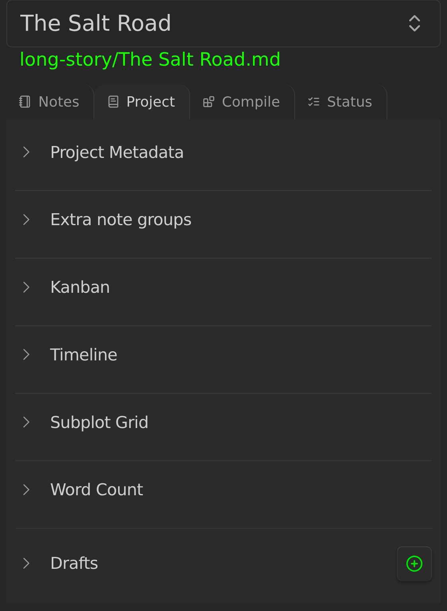
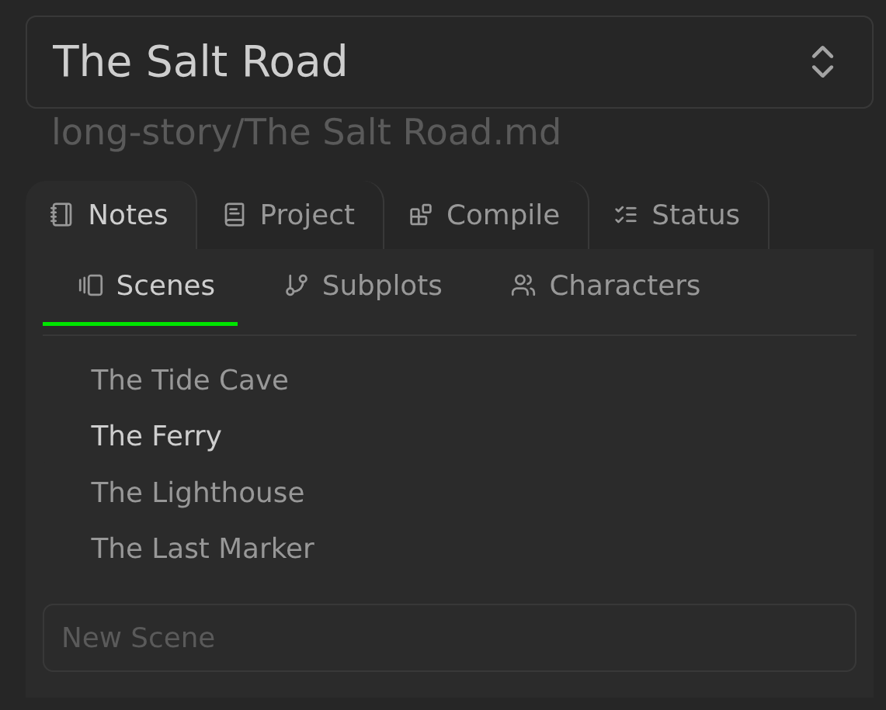
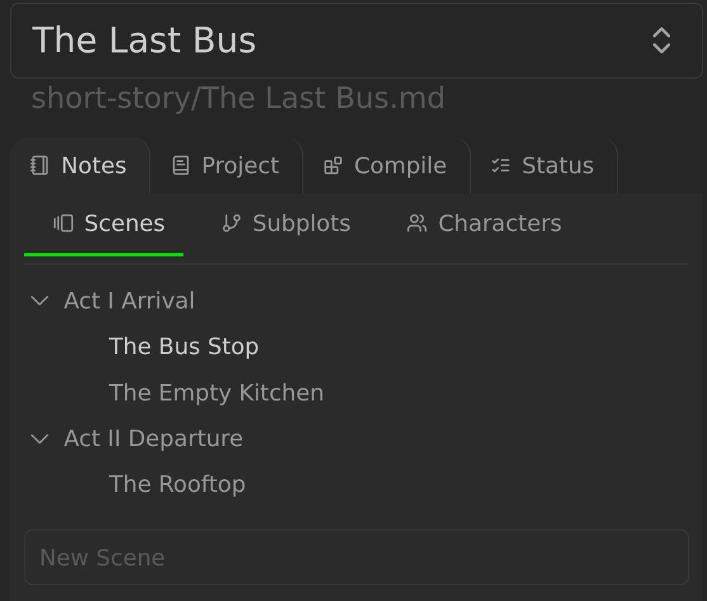
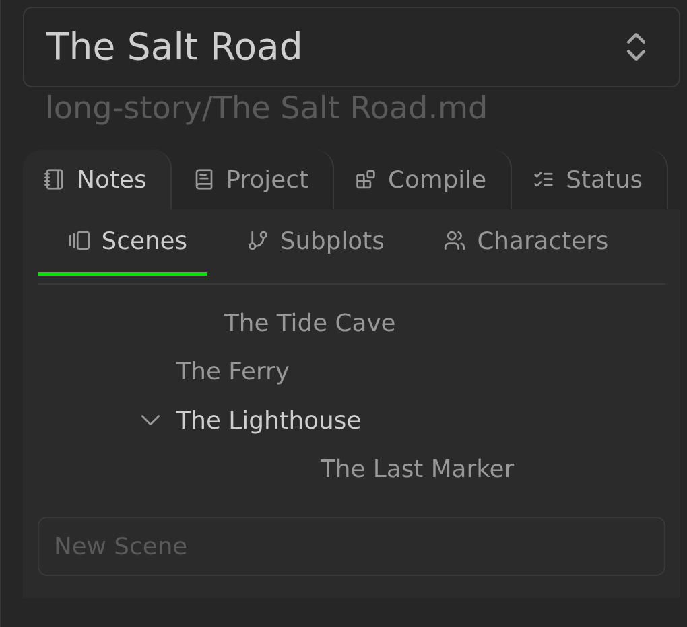

# Multi-scene Projects in Longform Extended

In Longform Extended, a project can either be [single-scene](./SINGLE_SCENE_PROJECTS.md) or multi-scene. Multi-scene projects order a set of notes that live in the same folder. These notes are referred to as _scenes_.

Multi-scene projects have four tabs: **Notes**, **Project**, **Compile**, and **Status**. **Notes** contains sub-tabs for the configured note groups: **Scenes**, **Subplots**, and **Characters** by default, plus any extra note groups. The **Scenes** sub-tab gives you a lot of features to manage your work as it grows; the others are described in [Subplots, Characters, and Extra note groups](./PLOTS_AND_CHARACTERS.md). The **Project** tab holds project metadata and the Timeline, Kanban, and Subplot Grid settings, and the **Status** tab has the generated-file actions described in [Status tab](./STATUS_TAB.md).



## Scene Ordering

Fundamentally, scenes are a manually-ordered set of notes. The **Notes → Scenes** sub-tab lets you reorder these notes with drag-and-drop. Your list of scenes corresponds to a frontmatter array in your [index file](./INDEX_FILE.md), so:



corresponds to:

```yaml
longform:
  scenes:
    - The Tide Cave
    - The Ferry
    - The Lighthouse
    - The Last Marker
```

Reordering the list in the **Scenes** sub-tab with drag-and-drop will reorder this frontmatter array (see [The Index File](./INDEX_FILE.md) for more details on how this works). You also have access to undo/redo when focused on the Longform Extended pane: cmd (ctrl on Windows)-z and cmd-shift-z will undo or redo your scene reorderings to a depth of 20 changes.

## Scene Indentation & Nesting

Although the Scenes sub-tab does not correspond directly to a file hierarchy, you can indent and nest scenes as you see fit. For example, the acts here are structural containers with their scenes nested underneath:



Clicking the disclosure arrow next to `Act I Arrival` hides its scenes. As you might expect, indentations are also reflected in your index file’s frontmatter:

```yaml
longform:
  scenes:
    - Act I Arrival
    - - The Bus Stop
      - The Empty Kitchen
    - Act II Departure
    - - The Rooftop
```

Longform Extended takes advantage of YAML’s syntax for nested arrays to “indent” the frontmatter and make it look like your hierarchy.

There are two ways to change the indentation level of a scene:

1. With the mouse, by dragging left and right on a scene.
2. With the **Indent scene** and **Unindent scene** commands. These commands are only available while editing a scene, and they also indent subplot, character, and extra-group notes in their sub-tabs.

Because your scene list does not directly correspond to a file system, your **indentation does not need to look like a file hierarchy**. For example, this is totally valid in Longform Extended:



Here’s the YAML, if you’re curious:

```yaml
longform:
  scenes:
    - - - first scene
      - second scene
    - third scene
    - - - - - - - fourth
```

What does this mean? Who knows! It’s your project, organize it how you want.

Longform Extended includes a documented [API](https://github.com/wandrade/longformExtended/blob/main/src/api/LongformAPI.ts) that can parse and create these YAML lists.

## Unknown Scenes & Ignored Scenes

If Longform Extended detects a `.md` file in your project’s scene folder that it doesn’t know about it will prompt you to add it to your project. When a new file is detected you can either:

- **Add** it, in which case it is appended as a scene to your scene list (you can then reorder as needed), or
- **Ignore** it, in which the filename (without the `.md` extension) is added to your project’s `ignoredFiles` list.

The wizard also offers **Add all** and **Ignore all**. The scene right-click menu
includes **Ignore note in longform extended**.

Ignored files can exist alongside your scenes without appearing in your scenes list or being compiled. The `ignoredFiles` property supports wildcards. If, for example, you wanted to keep scratch notes alongside each scene, suffix them with `-scratch.md` and add the following to the `longform` entry in your index file’s frontmatter:

```yaml
longform:
  ignoredFiles:
    - "*-scratch"
```
