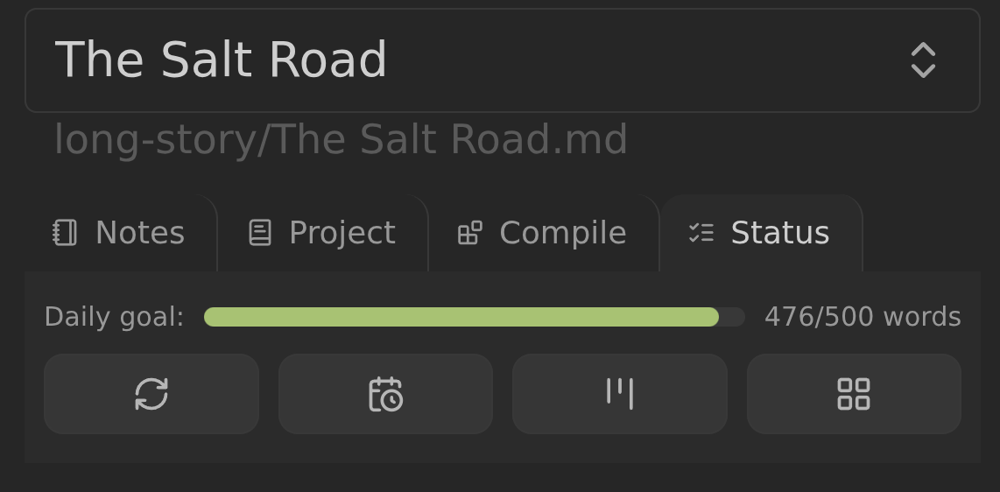
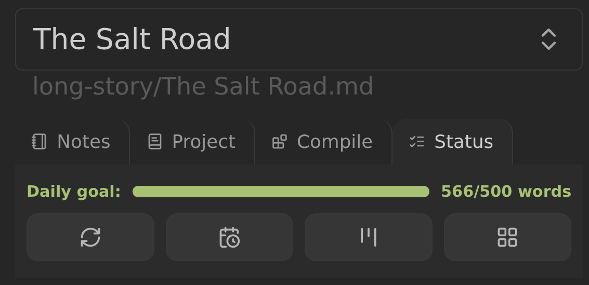

# Overview

Multi-scene projects show an **Overview** block at the top of the Longform
Extended pane, always visible above the **Notes**, **Project**, and **Compile**
tabs. It holds the daily writing-goal bar and the actions that work with the
project and its generated files. Single-scene projects do not show an Overview
block.

## Daily Goal Bar

The bar shows the current session's progress toward the writing goal. Its label
turns green and bold when the goal is met. It uses the latest writing session and
the **Goal applies to** setting, and is hidden when the goal is `0` or less or
when the selected scope has no measurable target.

See [Word counts and sessions](./WORD_COUNTS.md#the-daily-goal-bar) for the
scopes, settings, and storage options.

## Actions

The block has five icon actions:

- **Compile** (tooltip: “Compile manuscript”) compiles the selected project
  with its current compile workflow. It is disabled when no workflow is
  selected, and while a refresh is running.
- **Refresh** (tooltip: “Force immediate generation of status files.”)
  regenerates every enabled generated file for the selected project: the
  timeline, the kanban board, and the subplot grid. It also writes the kanban
  word counts. It is disabled while it runs, and when no generated file is
  enabled.
- **Open timeline** opens the configured timeline note. It is disabled when the
  timeline is off.
- **Open kanban** opens the configured kanban board. It is disabled when the
  kanban is off.
- **Open subplot grid** opens the configured subplot-grid Base. It is disabled
  when the subplot grid is off.

The same compile and refresh work can run on a per-project timer, configured
with [Autocompile](./COMPILE.md#autocompile) in the Project tab.

If an open action's file has not been generated yet, a notice asks you to use
the refresh action. Only the subplot-grid action's tooltip follows the project's
display names, so a Subplots display name of `Threads` produces an “Open thread
grid” tooltip. The timeline and kanban tooltips are fixed. See
[Display names](./PLOTS_AND_CHARACTERS.md#display-names).

## Layout

The five actions sit in a grid and never shrink below a square. When the pane is
narrow they wrap onto multiple rows, split evenly, with an odd count leaving the
extra button on the first row.

## Related

- [Timeline](./TIMELINE.md#updating-and-rebuilding)
- [Kanban](./KANBAN.md#updating-and-rebuilding)
- [Subplot Grid](./PLOT_GRID.md#updating-and-rebuilding)
- [Word counts and sessions](./WORD_COUNTS.md)
