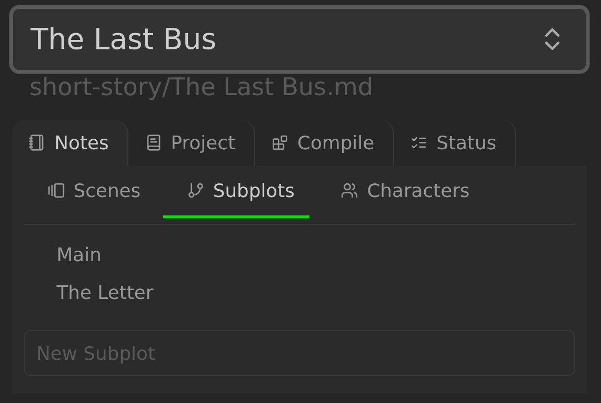
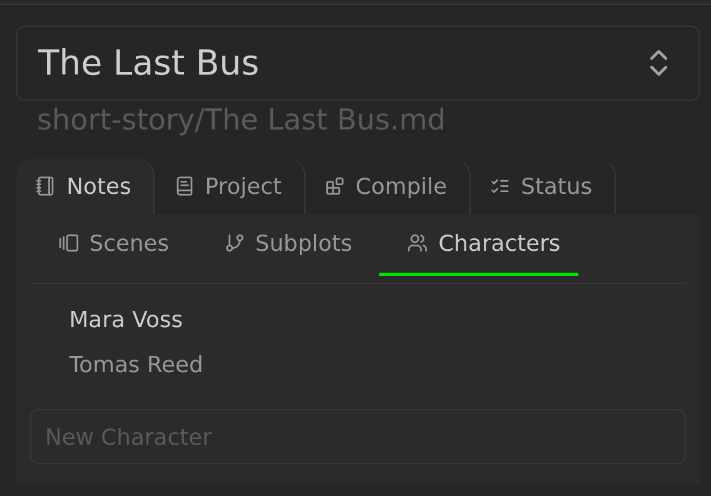
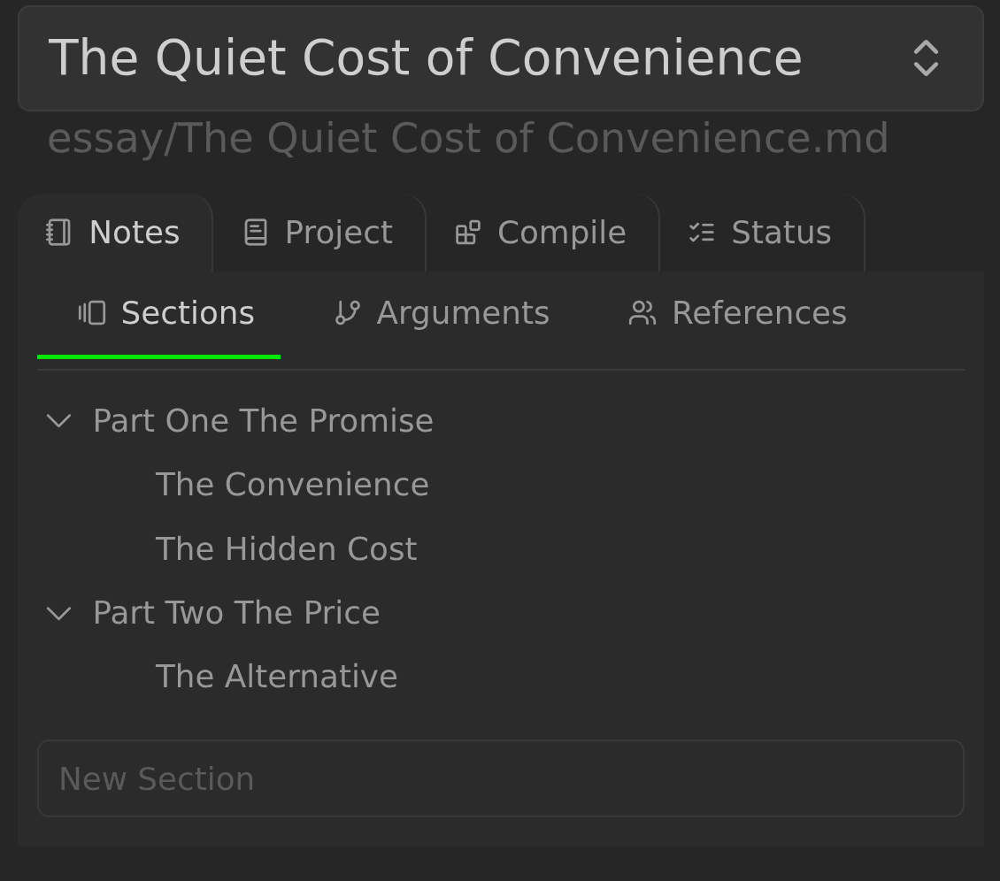
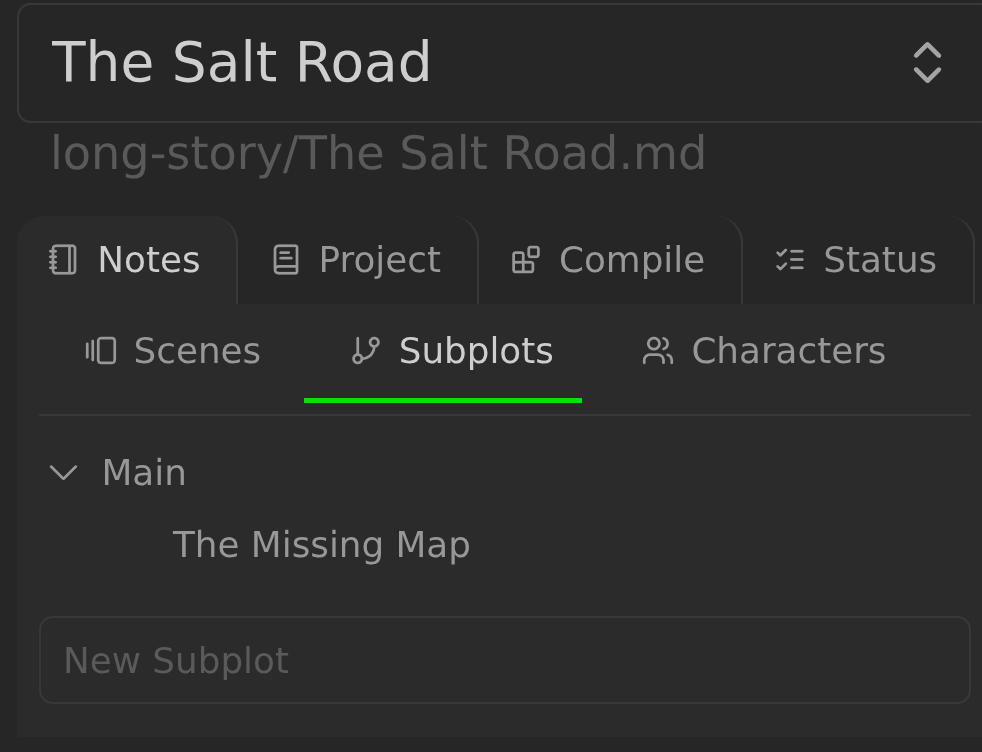

# Subplots, Characters, and Extra note groups

Multi-scene projects get a **Notes** tab in the Longform Extended pane. Its
sub-tabs are the configured note groups: **Scenes**, **Subplots**, and
**Characters** by default, plus any extra groups. The pane opens on
**Notes → Scenes**. The **Scenes** sub-tab lists the project's scene list from
the index file; the other sub-tabs list the Markdown notes in their configured
folders. Each sub-tab lets you create, rename, reorder, and nest those notes.
Single-scene projects have only **Project** and **Compile**. Choosing **Notes**
redirects to **Project**.





For Subplots, Characters, and custom groups, membership comes from the
configured folders. There is no `type` flag: a Markdown note under the Subplot
Folder is a subplot (`Main` is the main plot), and one under the Character
Folder is a character. See
[PLOT_GRID.md](./PLOT_GRID.md#folders) for the folder settings and
[Extra note groups](#extra-note-groups).

The subplot, character, and custom group sub-tabs are organizational; the grid
and timeline read their folders directly. The **Scenes** sub-tab is different:
its order and indentation define the hierarchy used by compile, the grid, and
the timeline. See [Relationship to the Subplot Grid and Timeline](#relationship-to-the-subplot-grid-and-timeline).

## Display Names

The three built-in groups have per-project display names, configured in the
**Project Metadata** section of the Project tab:

| Field | Default |
| --- | --- |
| **Scenes Display Name** | `Scenes` |
| **Subplots Display Name** | `Subplots` |
| **Characters Display Name** | `Characters` |



A blank field falls back to the default. Display names are presentation only.
They change labels throughout the plugin and its generated output:

- the **Notes** sub-tabs and the **New …** create fields;
- labels in **Project Details**, including the folder and template fields;
- the subplot grid's view title and its row-label prefixes;
- the timeline subplot table's first column;
- labels derived from subplots in the Overview block and in Kanban, such as the
  **Open subplot grid** action and the **Include subplots** checkbox.

They do not change folder settings, folder paths, note paths, frontmatter keys,
or which notes belong to a group. Renaming a display name never renames or moves
a folder or note; the folder remains governed by its own folder setting.

Singular labels are derived from the plural display name: a trailing `s` is
dropped, and a trailing `ies` becomes `y`. For example, `Arguments` becomes
`Argument`, `Stories` becomes `Story`, and `Magic` stays `Magic`. The defaults
therefore produce **Scene**, **Subplot**, and **Character**.

An extra group's configured name is its display name; there is no separate
display-name field for extra groups.

## Folders and Membership

For Subplots, Characters, and custom groups, the configured folders decide
membership, including nested subfolders; other file types are ignored. Scenes
are the exception: membership comes from the `scenes` list, and only direct
children of the Scene Folder are considered. See
[Unknown Scenes & Ignored Scenes](./MULTIPLE_SCENE_PROJECTS.md#unknown-scenes--ignored-scenes).
The rules below apply to every group folder:

- Folder settings are relative to the project folder. A leading `/` is only a
  separator; it does not mean the vault root. (That rule applies only to output
  file paths.)
- New projects default the Scene Folder to `Scenes`, the Subplot Folder to
  `Subplots`, and the Character Folder to `Characters`. An empty Subplot or
  Character Folder setting falls back to its default.
- A new extra group's folder defaults to the group name with spaces replaced by
  underscores (`Magic System` → `Magic_System`). An empty folder setting falls
  back to that same derived default. A folder value you type is used as typed;
  it is not rewritten.
- Every configured group folder — Scenes, Subplots, Characters, and every extra
  group — must be **pairwise distinct** and **non-nested**. No two groups may
  use the same folder, and no group's folder may be a subfolder of another
  group's folder.
- A Scene Folder of `/` resolves to the project folder, which contains the
  other group folders, so it conflicts with every other group.

**Project Details** shows an inline error for each conflict and rejects an
invalid folder edit: the field reverts to its stored value and a notice explains
the conflict. For how the distinct/non-nested rule affects the subplot grid,
see [PLOT_GRID.md](./PLOT_GRID.md#folders).

Changing a folder setting does not move notes. If you want a group to use a
different folder, move its notes in your vault first, then change the setting.
The Scene Folder must already exist; an edit that points at a missing folder is
not applied.

## Extra note groups

The **Extra note groups** section of the Project tab defines project-specific groups.
It is empty by default. The list holds group names separated by spaces; quote a
name that contains spaces with single or double quotes:

```
Locations "Magic System" Factions
```

The order of the names is the order of the Notes sub-tabs. Duplicate names are
ignored, and a name must not be empty.

Each group gets:

- its own Notes sub-tab, labeled with the group name;
- a folder setting that defaults to the group name with spaces replaced by
  underscores (`Magic System` → `Magic_System`) and can be changed with the same
  project-folder-relative path rules as the built-in folders;
- an optional **Template** file setting, next to its folder setting, used when
  creating notes in that group; empty means no template;
- its own order/indent overlay, stored on the group in the index file; and
- the same tree behavior as the Subplots and Characters sub-tabs: reorder,
  indent and unindent, collapse, open, inline rename, delete to the trash, add
  above or below, and open in a new pane.

A new extra group has no notes until its folder contains Markdown notes.
Notes created for an extra group use that group's optional **Template**
setting when one is configured; otherwise they are created empty.

Extra note groups currently get sub-tabs, trees, and creation only. They are
not subplot-grid rows or columns and are not timeline rows. They are also not
included in the Kanban board, even with **Include subplots** on. They do still
participate in the folder validation described above.

### Removing or Renaming a Group

Removing a group means deleting its name from the **Extra note groups** list. This is
configuration-only: it never deletes the group's folder, its notes, or any other
group's data. The removed group's index entry (including its optional
template setting and order/indent overlay) is dropped, but the notes remain on
disk and are not moved. If you add a group with the same name and folder again,
those notes appear in its sub-tab after the next sync.

Renaming a group in the list is also configuration-only. It is treated as
removing the old name and adding a new group: the old folder and notes are left
untouched, the new group's folder defaults to the new name with spaces replaced
by underscores, and its overlay is rebuilt from the folder it points at. To keep
an existing group's notes after a rename, set the new group's folder to the old
group's folder. A template is not carried over automatically; select it again
if the renamed group should use one.

## Creating Notes

Each sub-tab has a **New** field at the bottom, labeled with that group's
singular name: **New Subplot** and **New Character** for the built-ins, or
**New Location** for an extra group named Locations.

- Press **Enter** to create the note and open it.
- Press **Shift+Enter** to create the note without opening it.
- Press **Escape** to clear the field.

When the kanban is enabled, a new subplot note is also given the first kanban
column as its `status`, unless its template already sets one. Character notes
and custom-group notes never get a status.

A name that matches an existing entry in that sub-tab, or that contains
characters that are not valid in a file name, is rejected with an inline error
and no note is created. Duplicate and invalid-name notices use the subplot,
character, or extra group's singular wording. The note is written to the
configured folder at its root; missing parent folders are created.

For auxiliary groups, notes created outside the pane are picked up on the next
sync. For Scenes, an unlisted file must be added through the unknown-file
prompt. See
[Unknown Scenes & Ignored Scenes](./MULTIPLE_SCENE_PROJECTS.md#unknown-scenes--ignored-scenes).

### Templates

New notes use a template when one is configured:

- **Per project:** **Subplot Template** and **Character Template** are in the
  **Project Metadata** section of the Project tab, next to **Scene Template**.
- **Global fallback:** **New subplot template** and **New character template**
  in the plugin settings, under **Composition**. They apply to every project
  and are overridden by a project's own template.
- All of these template settings default to none.

Template paths are vault-relative, and the file must exist; an invalid path is
not saved.

Templates are processed the same way as scene templates. If Templater is
enabled, it processes the template; otherwise, if Obsidian's core Templates
plugin is enabled, that is used. With neither enabled, the new note is created
empty. Template errors are logged, and the note remains created.

An extra group has no project-wide or global fallback; it uses only its own
optional **Template** setting, and creates an empty note when that setting is
empty.

The **Add new subplot/character above** and **Add new subplot/character below**
menu items also create their note through this template workflow, using a unique
`Untitled` name and opening the new note. The equivalent extra-group menu items
use the group's optional **Template** setting in the same way.

## Organizing the Tree

All Notes sub-tabs, built-in and extra, support the same tree operations:

- **Reorder** by dragging a note up or down.
- **Indent** by dragging a note horizontally, or with the global **Indent
  scene** and **Unindent scene** commands while the subplot, character, or
  extra-group note is active. Unindent is unavailable at the top level.
- **Collapse** a note that has children with its disclosure arrow.
- **Open** a note by clicking it. Modifier-click and middle-click follow
  Obsidian's usual link behavior.
- **Rename** inline from the right-click menu: Enter commits, and Escape or
  clicking away cancels. The renamed note is written to the root of its
  configured folder, even if it was previously in a nested subfolder.
- **Delete** from the right-click menu. The note is moved to the trash.
- **Add above** or **Add below** from the right-click menu. The new note is
  created in the configured folder and opened.
- **Open in new pane** from the right-click menu.

The right-click menu is available on desktop.



## Membership and Order Overlay

For Subplots, Characters, and custom groups, the project note stores a small
order/indent overlay for each group. It records only the displayed order and
indentation. It does not decide which notes exist. The overlay is reconciled
with the folder when the project loads or syncs:

- Entries whose notes are gone are removed.
- Notes that are missing from the overlay are appended at the top level
  (indent 0), in alphabetical order.
- Creation adds the note and an overlay entry at the requested position.
- Reordering and indenting change only the overlay; the notes are not moved.
- Deleting a note removes its entry.
- Renaming or moving a note updates its entry. A rename within the same tree
  keeps its position and indentation; moving a note out removes the entry, and
  moving one in appends it at the top level.

The overlay is keyed by basename. If two notes in nested subfolders share a
basename, only the first one in path order appears in the sub-tab; the overlay
cannot represent both. Keep basenames unique within a group. The inline
rename always targets the configured folder root, so renaming a note from a
nested subfolder also moves it to that root.

Scenes do not use this overlay; their order and indentation live in the `scenes`
list. A missing scene note is dropped on sync, and an unlisted folder file becomes
an unknown file. See
[Multiple-scene projects](./MULTIPLE_SCENE_PROJECTS.md#unknown-scenes--ignored-scenes).

## Relationship to the Subplot Grid and Timeline

The subplot grid and timeline do not use the sub-tab overlays for Subplots and
Characters:

- The **subplot grid** scans the Subplot and Character Folders for its notes.
  They are columns in the custom view and rows in the native fallback table.
  Its note order is its own: `Main` first (the main plot), then the other
  subplots, then characters, alphabetical within each group. Sub-tab order and
  indentation do not affect the grid. Extra groups are not scanned and do not
  become rows or columns.
- The **timeline subplot tables** read the Subplot Folder for their subplot
  rows. Sub-tab order and indentation do not affect which subplots appear, their
  order, or which scenes they mention. Extra groups do not become timeline
  rows.

The Scenes tree differs: its order and indentation define the grid's levels and
the timeline's per-level tables. See [Subplot Grid](./PLOT_GRID.md#levels) and
[Timeline](./TIMELINE.md).

Generating the subplot grid requires the Scene, Subplot, and Character Folders
to be pairwise distinct and non-nested. The timeline reads only the Subplot
Folder. Extra groups are not grid or timeline inputs, but their folders are
still part of the Project tab's all-groups validation. See
[PLOT_GRID.md](./PLOT_GRID.md#folders).

## Troubleshooting

- **A note is missing from the sub-tab.** For auxiliary groups, check that it is
  a Markdown file under the configured folder and that its basename is unique.
  For Scenes, check that it is in the `scenes` list and directly in the Scene
  Folder.
- **A note is in a sub-tab but not in the grid or timeline.** Extra groups are
  not view inputs; check the subplot grid's level or the timeline's timeframes.
- **A label shows an unexpected word.** A built-in group's display name was
  changed in **Project Metadata**. Display names change labels only; they do not
  change folders or data. Clear the field to return to the default.
- **A folder edit is rejected.** All group folders must be pairwise distinct
  and non-nested. The field reverts to its stored value and a notice names the
  conflicting groups. Change one of the folders so no group equals or contains
  another.
- **An extra group's notes are missing.** Confirm the group is still listed in
  **Extra note groups**, that its folder points at the folder containing the notes,
  and that the notes are Markdown files. Notes are not deleted when a group is
  removed from the list; re-add the group to see them again.
- **A removed extra group's folder still exists.** Removing a group is
  configuration-only. It never deletes the folder or its notes; delete them
  yourself if you no longer want them.
- **The template was not applied.** Templates for the built-in Subplots and
  Characters groups apply to notes created from the New field or the
  add-above/add-below menu. An extra group uses only its own **Template**
  setting, with no project-wide or global fallback. Check the relevant template
  setting and confirm Templater or the core Templates plugin is enabled.
- **A note was moved after renaming.** Inline rename always writes to the root
  of the configured folder; move the note back into a subfolder afterwards if
  you want it nested on disk.
- **The Notes sub-tabs are missing.** The Notes sub-tabs are available only for
  multi-scene projects, under **Notes**.
