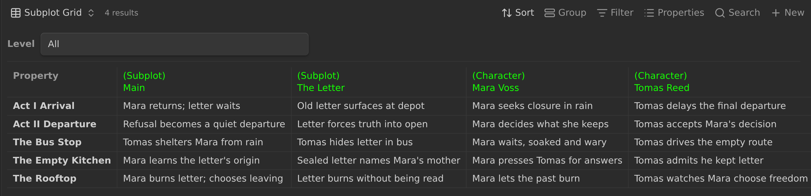
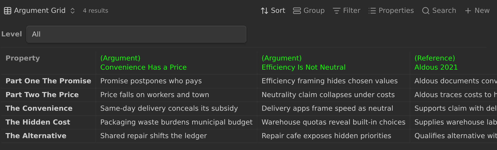

# Subplot Grid

A project with scenes can generate a subplot grid: a table that tracks your
subplots and characters across the structure of your story. Cells are editable,
and an edit is written back into the corresponding subplot or character note's
frontmatter.





The grid is a native Obsidian Bases file (`.base`). Its custom transposed view
puts the subplot and character notes in columns and the hierarchy nodes in rows
for easier reading; the native fallback table shows the notes as rows. A
**Level** dropdown above the table chooses which level's rows to display, or
**All**.

The `.base` is generated from project data. Edit cells in the grid, not in the
Base file: regeneration overwrites the file.

## Requirements

- **Obsidian 1.14 or newer.** This is the plugin's minimum version; it includes
  the Bases view API used by the custom view.
- **Longform Extended enabled.** The custom view is registered by the plugin.
- **The Bases core plugin enabled.** If it is disabled, the custom view is not
  available; the generated Base still includes a native table view as a
  fallback.
- **A multi-scene project.** Single-scene projects do not get a subplot grid.
- **Markdown notes in the configured folders.** Every Markdown note under the
  Subplot Folder is a subplot note (the note named `Main` is the main plot; the
  others are subplots), and every Markdown note under the Character Folder is a
  character note. In the custom view these notes are columns; in the native
  fallback table they are rows. See [Folders](#folders).

## Configuration

The Subplot Grid section of the Project tab controls the feature:

| Setting | Default | What it does |
| --- | --- | --- |
| **Enable subplot grid** | On | Turns generation on or off. |
| **Subplot Grid Output Path** | `Build/$1_plotgrid.base` | Where the Base is written. |

The **Level** selector is part of the generated view, not the Project tab. See
[Levels](#levels).

### Display Names

The grid's labels come from the project's display names for the Subplots and
Characters groups, configured under **Project Metadata** (defaults `Subplots`
and `Characters`). The singular form is derived from the plural display name
(`Threads` → `Thread`, `Stories` → `Story`).

- The custom view is titled with the configured singular name plus `Grid`
  (default **Subplot Grid**).
- The native fallback view uses that same title plus `(Table)` (default
  **Subplot Grid (Table)**).
- Row-label prefixes use the configured singular names, so notes are labeled
  `(Subplot)` and `(Character)` by default, or `(Thread)` and `(Cast)` when the
  display names are `Threads` and `Cast`.
- The Status tab's open action and its tooltip use the configured singular name.

Display names are presentation only. They do not change the Scene, Subplot, or
Character Folders, note paths, `plotgrid_*` keys, or data. A blank display name
falls back to its default. See
[PLOTS_AND_CHARACTERS.md](./PLOTS_AND_CHARACTERS.md#display-names).

Extra note groups are not subplot-grid inputs; see
[Extra note groups](./PLOTS_AND_CHARACTERS.md#extra-note-groups).

Turning **Enable subplot grid** off stops future rebuilds and removes the
**Rebuild subplot grid** command for that project; the Status tab's
**Open subplot grid** action stays visible but is disabled. Turning it off does
not delete an existing Base or the `plotgrid_*` keys already in notes.

These folders are not configured in the Subplot Grid section. **Scene Folder**,
**Subplot Folder**, and **Character Folder** are configured in **Project
Metadata**. See [Folders](#folders).

### Folders

**Scene Folder**, **Subplot Folder**, and **Character Folder** all live in
the **Project Metadata** section of the Project tab. They share the same folder
autocomplete, which suggests folders relative to the project folder. All three
are project-folder-relative; a leading `/` does not mean the vault root. (That
rule applies only to output file paths.) New projects default the scene folder
to `Scenes`, the Subplot Folder to `Subplots`, and the Character Folder to
`Characters`. Existing projects may keep custom Subplot or Character Folder
names. An empty Subplot or Character Folder setting falls back to its default.

Migrated legacy projects may still have a project-root scene folder (`/`),
which resolves to the project folder itself.
That folder contains the subplot and character folders, so the configuration is
nested. Choose a distinct, non-nested scene folder before the subplot grid will
generate.

The three folders must be pairwise **distinct** and **non-nested**; if the
configuration breaks this rule, generation is blocked and a manual rebuild
reports a Notice. No Base or `plotgrid_*` keys are written until the paths are
fixed. See
[Folders and membership](./PLOTS_AND_CHARACTERS.md#folders-and-membership) for
the full rule and the Project tab's validation of every group.

Every Markdown note under the Subplot Folder is a subplot note, and every
Markdown note under the Character Folder is a character note. The note named
`Main` is the main plot; the other notes in the Subplot Folder are subplots.
A note outside those folders never appears: folder membership is the only
source of truth. Nested subfolders are included. Other file types are ignored.

The same folders feed the **Notes → Subplots** and **Notes → Characters**
sub-tabs, but the sub-tabs keep only a project-level order and indentation
overlay. The subplot grid does not use that overlay: it scans the folders directly
and applies its own note order (`Main` first, then subplots, then characters).
New subplot and character notes are created in these folders with the project
templates. See
[PLOTS_AND_CHARACTERS.md](./PLOTS_AND_CHARACTERS.md).

## Levels

The subplot grid generates rows for every populated level of the hierarchy. The
generated grid view has a **Level** dropdown above the table; choosing
a level filters the view to that level's rows. This selector is not a project
setting and is not stored in the project frontmatter. Any legacy
`plotGridLevel` value is dropped when the project is saved.

A level is the **zero-based rank of the distinct indentation values** in the
project's scene list, not a raw indentation number:

```
Act 1                    rank 0
  Chapter 1              rank 1
    Scene 1              rank 2
    Scene 2
  Chapter 2
    Scene 3
Act 2                    rank 0
  Chapter 3
    Scene 4
```

For that hierarchy:

- **Level 0** produces the `Act 1` and `Act 2` rows.
- **Level 1** produces the `Chapter 1`, `Chapter 2`, and `Chapter 3` rows.
- **Level 2** produces the scene rows.

The dropdown lists **All** first, then each populated level. Labels are built
from the hierarchy and show up to three node titles, for example:

```
All
0 - (Act 1 - The Beginning, Act 2 - The Choice)
1 - (Chapter 1 - Arrival, …)
2 - (Scene 1 - The Train, …)
```

Only levels that contain nodes appear. The default selection is level 0 when it
exists; otherwise the first populated level, otherwise **All**. Selecting a
level filters the table; **All** shows every level.

Rows follow the **Scenes** tab/tree document order for the selected level.
**All** groups the levels top-down (level 0, level 1, and so on), with each
level's rows in tree order. Selecting a level does not regenerate the Base.

All levels' `plotgrid_*` keys are generated and preserved. The custom view
shows only the selected level's rows; other levels' keys stay in the notes,
hidden, so switching back restores them. The native fallback table is not
filtered by the dropdown: it shows all levels' columns.

The act/chapter/scene hierarchy is only an example; levels are ranks. Structural
nodes need their own note files in the scene folder, as scenes do elsewhere in
Longform Extended; otherwise Longform Extended drops them and the levels shift.

### Structural Notes Must Exist

Longform Extended builds its in-memory scene hierarchy from entries in the
project's `scenes` frontmatter that have a matching note directly in the scene
folder. Structural nodes are not special: if you add one to the hierarchy but
never create its note, Longform Extended filters it out.

The symptom is that a level seems to collapse or shift. A project whose
hierarchy lists structural nodes and scenes but only has scene notes will lose
the structural nodes, making level 0 a deeper level. To fix it, create a note
in the scene folder named exactly like each structural entry; because loading
prunes scene entries with no matching note, the new note appears as an unknown
file and must be added through the unknown-file prompt in the **Scenes**
sub-tab. Adding appends it to the end of the scene list, so re-indent it to
restore its intended level.

## Data and YAML

The note columns (or rows, in the native fallback table) are the Markdown notes
under the Subplot and Character Folders. In the custom view a note named `Main`
(matched case-insensitively) in the Subplot Folder is the main plot and comes
first, then the other subplots, then the characters, each group alphabetical by
note name.

Each note gets one `plotgrid_<title>` key per hierarchy node at every populated
level. The title is lowercased, runs of non-alphanumeric characters become one
`_`, and leading or trailing `_` characters are removed; a title with no letters
or digits becomes `node` (so `plotgrid_node`). Same-level collisions get `_2`,
`_3`, and so on. Keys are not namespaced by level: if nodes at different levels
produce the same key, they share one cell. For example, `Chapter 1` becomes
`plotgrid_chapter_1`.

The plugin manages these keys:

- Missing keys for a populated level are added with an empty string value.
- Existing `plotgrid_*` keys are kept, including keys for levels you are not
  viewing. Values of existing keys and every key outside the namespace are
  never modified.
- A note is rewritten only when a key is added or a legacy key is migrated.
  Legacy ancestor-path keys are migrated automatically, and other levels' keys
  are never deleted.

The `plotgrid_` namespace is plugin-managed. You can see the keys in Obsidian's
Properties panel, but edit cells in the grid rather than editing the keys by
hand. Do not use the namespace for your own properties.

Every Markdown note under the subplot and character folders receives these
keys. There is no flag to opt out, so keep reference notes, templates, or other
unrelated Markdown out of those folders if you do not want them in the grid.

## The Generated Base

The Base is written to the path set in **Subplot Grid Output Path**. The default
is `Build/$1_plotgrid.base`, where `$1` is replaced with the project title. An
existing project with an explicit output path keeps it; only the default
changed, so a stored path is not rewritten or moved. See
[Generated files](./GENERATED_FILES.md) for the shared output rules.

The generated file contains:

- A filter over the subplot and character folders, OR-combined. Because the
  folders are distinct and non-nested, a note matches at most one of them,
  and folder membership alone decides whether it is a subplot or a character.
- The custom transposed view first, titled with the configured singular name
  plus `Grid` (default **Subplot Grid**). It has a **Level** dropdown above the
  table, shows the selected level's hierarchy nodes as rows, and shows the notes
  as columns.
- A native table view as a fallback, titled with the same name plus `(Table)`
  (default **Subplot Grid (Table)**). Its rows are notes and its columns are the
  properties for all levels; it is not filtered by the custom view's Level
  dropdown. The fallback uses the same order: `Main` first, then subplots, then
  characters.
- Column display names set to the hierarchy titles, and a row-label formula.

In the custom view, each note header is a link that opens the source note.
Because the subplot and character folders are distinct, the label is the
configured singular display name in parentheses — `(Subplot)` or `(Character)`
by default — on its own line above the name. The native table uses a row-label
formula that emits the same prefix; its row style may keep the prefix and name
on one line.

Each cell displays the value stored under that column's `plotgrid_*` key.
Because keys are not namespaced by level, nodes at different levels that produce
the same key share one column and one value: in that case a higher-level row and
the deeper node show the same cell.

Cell edits go to the note frontmatter and survive.

No Base is written when the feature is disabled, when the hierarchy has no
populated levels, when there are no notes under the folders, or when the three
folders are not distinct and non-nested. In those cases an existing Base at
the configured path is left untouched.

## Editing

Click a cell to edit it. The editor follows the value's type:

- A text value gets a text field.
- A number gets a number field.
- A boolean gets a checkbox.

Press Enter or click away to commit; press Escape to cancel. A checkbox also
commits immediately when toggled. The new value is written to the note's
frontmatter under that column's `plotgrid_*` key, using Obsidian's frontmatter
API.

Only `plotgrid_*` cells are editable in the custom view. `file.*` and
`formula.*` properties are not offered as rows, and list or object values are
shown read-only rather than being replaced with text. The custom view keeps
focus while a write refreshes the grid, so editing a cell does not close the
editor mid-entry.

Clicking a note header opens that subplot or character note.

## Updating and Rebuilding

The subplot grid refreshes automatically:

- when the plugin loads;
- when project settings that affect it change (enabled, output path, the three
  folders, or the Subplots and Characters display names);
- when the scene hierarchy changes (titles or indentation);
- when files in the project, scene folder, or the subplot and character
  folders are created, modified, deleted, renamed, or re-indexed.

Generated outputs are excluded from triggering rebuilds, including Bases written
to custom output paths, so writing the grid does not loop. Choosing a level in
the view is client-side and does not rebuild the Base. Automatic skips (for
example, a hierarchy with no populated levels) are silent rather than shown as
notices; a manual **Rebuild subplot grid** reports the reason.

To force a rebuild, select the project and run **Rebuild subplot grid** from the
command palette. The command is only available for a multi-scene project with
the subplot grid enabled. It reports the number of columns and grid notes, or
the reason nothing was written.

The Status tab provides the shared actions described in
[Status tab](./STATUS_TAB.md):

- The refresh action regenerates every enabled generated file for the selected
  project: the timeline, the kanban board, and the subplot grid.
- **Open subplot grid** opens the configured Base. It is disabled when the
  subplot grid is off. If the file has not been generated, a notice asks you to
  use the refresh action.

Changing the output path writes a new Base at the new path but does not move or
delete the old one.

## Troubleshooting

- **No Base was created.** Check that the subplot grid is enabled, that the
  project is a scenes project, that the hierarchy has a populated level, and
  that the Subplot or Character Folder contains Markdown notes.
- **The dropdown's level 0 shows deeper nodes than expected.** Structural nodes
  without notes are filtered out, and loading prunes their scene entries.
  Create the missing notes, add them through the unknown-file prompt in the
  **Scenes** sub-tab, and re-indent them to restore their hierarchy position.
- **A level is missing from the dropdown.** Only populated levels appear.
- **A note is missing from the grid.** Confirm it is a Markdown file under the
  Subplot or Character Folder. Folder membership is the only requirement; there
  is no `type` flag.
- **The title or a row label uses an unexpected word.** A display name changed
  in **Project Metadata**. Display names change labels only; clear the field to
  return to the default.
- **The grid will not generate after editing a folder.** The Scene, Subplot,
  and Character Folders must be distinct and non-nested. See
  [Folders and membership](./PLOTS_AND_CHARACTERS.md#folders-and-membership).
- **A previous level's keys are still in the frontmatter.** This is expected;
  choose that level in the view to see and edit them.
- **My edits to the Base disappeared.** The Base is generated; edit cells in
  the grid instead.
- **The custom view is missing.** Enable Obsidian's Bases core plugin and
  reload.
- **The subplot grid stops updating after an update.** Reload Obsidian or
  re-enable the plugin, then rebuild.
