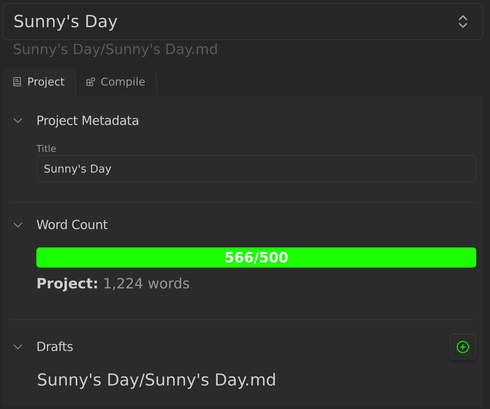

# Single-scene Projects in Longform Extended

In Longform Extended, a project can either be single-scene or [multi-scene](./MULTIPLE_SCENE_PROJECTS.md). A single-scene project is comprised of a single [index file](./INDEX_FILE.md) which is also the contents of your project. There are no additional notes.

This format is useful for (perhaps ironically) shorter-form projects, like short stories or essays.

These projects are available in the Longform Extended pane like any other project, but have only **Project** and **Compile** tabs. They have no **Notes** tab, and no **Status** tab; choosing either redirects to **Project**. The timeline, kanban, and subplot grid are multi-scene features and are not generated for single-scene projects.
